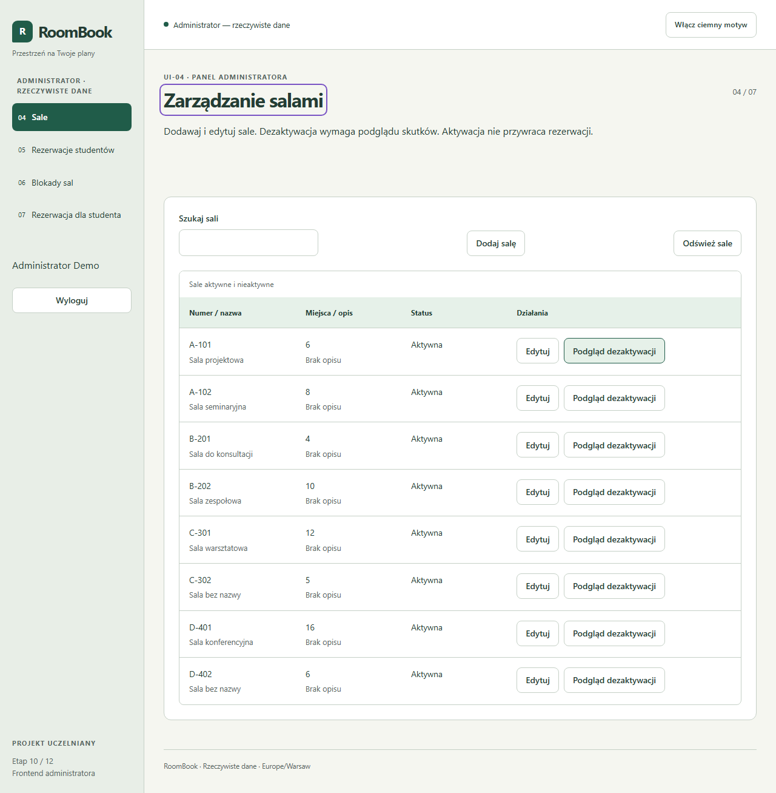
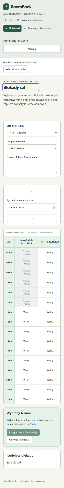

# RoomBook — audyt projektu do etapu 10/12

Data: 2026-11-09. Wynik: **brak blokujących usterek dla etapu 10**. Wszystkie wymienione niżej kontrole zakończyły się rzeczywistym sukcesem. Użytkownik zlecił audyt i zezwolił na zapisanie zmian na GitHub pod warunkiem poprawnego wyniku. Nie jest to deklaracja ukończenia etapów 11–12.

## Zakres i ocena kodu

Przejrzano specyfikację nadrzędną, wymagania WF/WN, kontrakty API, nawigację/makiety, diff etapu 10 oraz powiązane usługi administracji, transakcje SQLite, podpisy HMAC, autoryzację i obsługę sesji. Nie stwierdzono sprzeczności wymagającej zmiany specyfikacji, modelu danych ani UML.

Sprawdzono UI-04…07: zarządzanie salami bez kasowania historii, blokady 60/120 min, listę i anulowanie rezerwacji, tworzenie dla wskazanego studenta, wyjątki limitów administratora oraz nadal obowiązujące konflikty/harmonogram. Podpisany podgląd wiąże administratora, operację, salę, parametry i dokładne ID; UI nie generuje podpisu, nie zapisuje tokena trwale i nie loguje go. Ponowne wyliczenie skutków i zapis są w jednej transakcji. Nieaktualny podgląd nie powoduje cichych dodatkowych anulowań. Ochrona ról działa w renderze i niezależnie w API. Brak `test.only`/`test.skip` i analogicznych oznaczeń pomijających testy.

Zachowano wszystkie testy backendu i ścieżki studenta. Nowy test API sprawdza opis sali administratora bez zmiany DTO studenta. E2E prototypu administratora zastąpiono rzeczywistą ścieżką; liczba sal w regresji odpowiada aktualnej bazie testowej, w której test CRUD dodaje salę. Pozostałe testy studenta nie zostały usunięte ani wyłączone.

## Ustalenia i poprawki audytu

1. Audyt npm ujawnił 10 ostrzeżeń moderate w drzewie narzędzi ESLint/TypeScript ESLint. Produkcja miała 0. Dotyczyły jednej przyczyny: [GHSA-g3hv-75wg-m249](https://github.com/advisories/GHSA-g3hv-75wg-m249), usuniętej w minimatch 11.0.1. Sprawdzono zakresy i eksporty paczki. Dodano jawne `overrides.minimatch=11.0.1`, zachowując wersje ESLint i TypeScript ESLint. Lockfile zmienia minimatch i dodaje jego pośrednią zależność developerską `@isaacs/nonrecursive-glob-match`. Nie użyto `npm audit fix --force` ani downgrade'u narzędzi. Jest to świadome nadpisanie wersji głównej; zgodność potwierdzają czysta instalacja, lint, typowanie i regresja. Override należy usunąć lub ocenić ponownie, kiedy upstream przyjmie poprawioną bibliotekę.
2. Dodano wybór Firefox przez `PLAYWRIGHT_BROWSER=firefox`, zachowując domyślne Chromium i obsługę kanałów msedge/chrome. Obie przeglądarki przeszły ten sam kompletny zestaw.
3. Dodano cztery E2E audytowe: zmiana skutków blokady po podglądzie i nowy powód, utrata odpowiedzi już po rzeczywistym zapisie bez powtórnej mutacji, kolizja właściciela w innej sali po otwarciu dialogu oraz prawdziwe widoki desktop/mobile z kontrolą błędów JavaScript i zrzutami.
4. Zweryfikowano gotowy build API na odrębnej tymczasowej bazie i porcie 3019: health, logowanie, odczyt ośmiu sal, zerowy podgląd dezaktywacji i potwierdzony PATCH. Wynik `BUILT_API_SMOKE_PASS`.

Wcześniejsze poprawki implementacji (opis sali, pusty plik przed rzeczywistą migracją SQLite na Windows, powrót fokusu i wyścig hasha po loginie) opisuje [raport implementacji](ETAP_10_RAPORT.md). Ponowna pełna regresja potwierdziła ich poprawność. Czysta instalacja początkowo trafiła na EPERM pliku natywnego używanego przez kończący się Vite; po zakończeniu E2E wykonano ją ponownie z sukcesem. Nie resetowano prywatnej bazy i nie zamykano cudzych procesów.

## Wyniki wykonanych kontroli

Windows, Node 24.20.0, npm 11.19.1, Vitest 5.0.4, Playwright 1.64.1. Przeglądarki testowe: Chromium 156.0.8078.4 i Firefox 157.0. Uruchomienia mają zero pominiętych przypadków i wyłączone ślady sieci mogące zawierać poświadczenia. Testy używają rzeczywistych migracji i odrębnych plików SQLite oraz losowych sekretów/hasła w pamięci.

| Kontrola                                                                                                  | Wynik rzeczywisty                                                                            |
| --------------------------------------------------------------------------------------------------------- | -------------------------------------------------------------------------------------------- |
| `npm.cmd ci`                                                                                              | PASS — odtworzono 426 pakietów, audyt instalacji 0 podatności                                |
| `npm.cmd run lint`                                                                                        | PASS — ESLint i Prettier z poprawionym minimatch                                             |
| `npm.cmd run typecheck`                                                                                   | PASS — web, API i narzędzia                                                                  |
| `npm.cmd run db:validate`                                                                                 | PASS                                                                                         |
| `npm.cmd run build`                                                                                       | PASS — Vite i API TypeScript                                                                 |
| `npm.cmd run test`                                                                                        | PASS — 183/183, 11 plików, 40,46 s                                                           |
| `npm.cmd run test:e2e`                                                                                    | PASS — Chromium 24/24, 29,0 s                                                                |
| `$env:PLAYWRIGHT_BROWSER='firefox'; npm.cmd run test:e2e -- --output node_modules/.cache/firefox-results` | PASS — Firefox 24/24, 34,6 s                                                                 |
| Uruchomienie `apps/api/dist/server.js` i rzeczywiste HTTP                                                 | PASS — health/login/rooms/preview/confirm na tymczasowej bazie                               |
| `npm.cmd audit`                                                                                           | PASS — 0 podatności, kod 0                                                                   |
| `npm.cmd audit --omit=dev`                                                                                | PASS — 0 podatności, kod 0                                                                   |
| `git diff --check` i kontrola stagingu                                                                    | PASS — wyłącznie pliki etapu i audytu, bez sekretów, prywatnych DB, node_modules czy buildów |

Testy API obejmują m.in. role, limit, daty Warszawy/DST, kolizje i prawdziwą współbieżność na SQLite, atomowość, rollback, ważność/powiązanie HMAC oraz wymianę ID przy tej samej liczbie skutków. Nowe audytowe scenariusze UI dopełniają testy kontraktu i komponentów. Nie wykryto błędów JavaScript w czterech widokach administratora. Układ kontrolowano przy 375 i 1280 px; dotychczasowy test sprawdza też wszystkie siedem ekranów i oba motywy.

## Rzeczywisty wygląd

Zrzuty pochodzą z automatycznego uruchomienia lokalnego React z API i fikcyjnymi kontami seeda. Obejrzano zrzuty listy sal na desktopie i kalendarza blokad na telefonie: brak nakładania tekstu i przewijania całej strony; tabela kalendarza przewija się lokalnie.

## Git, autorstwo i publikacja

Punkt bazowy `967472be73282d8243caff508c5694be3b029e45` zawiera etap 09 autorstwa Krzysztof-S-TM; jego historię zachowano. Zdalny workflow bazowego etapu 09 był zielony. Wkład etapu 10 oraz audyt przygotował Codex na polecenie użytkownika. Tożsamość autora i commitera repozytorium pozostaje `Tomasz_L_TL <s10910tl@ms.wwsi.edu.pl>`; nie zmieniano konfiguracji, nie podszywano się pod autora etapu 09, nie backdatowano commitów i nie tworzono sztucznego podziału historii. Opis commita ujawnia użycie Codex.

Zgoda użytkownika obejmuje commit i push po pozytywnym audycie. Przed zapisem należy sprawdzić dokładną listę plików i brak zmiany origin/main. Identyfikator końcowego commita znajduje się w historii Git, a wynik jego GitHub Actions należy sprawdzić po push i podać osobno w podsumowaniu. Lokalny PASS nie jest przedstawiany jako wynik zdalnego CI. CI zachowuje dotychczasowy zakres: lint, typy, schemat, Vitest i build; E2E obu przeglądarek wykonano lokalnie.

## Pozostały zakres projektu

Etap 10 jest gotowy. Do etapów 11–12 pozostają test obciążenia WN-02/TC-23, pełna tabela końcowego pokrycia i audyt zaliczeniowy UML/C4/ERD/kod. Wykonano Playwright Chromium i Firefox, ale nie osobny stabilny kanał Google Chrome; nie deklaruje się pełnego ręcznego TC-25 ani pełnego audytu dostępności. Nie testowano nieprzewidzianego w specyfikacji hostingu produkcyjnego. API nadal nie ma paginacji, a limit 4 KiB dotyczy także potwierdzeń. Te ograniczenia nie stanowią regresji etapu 10.
