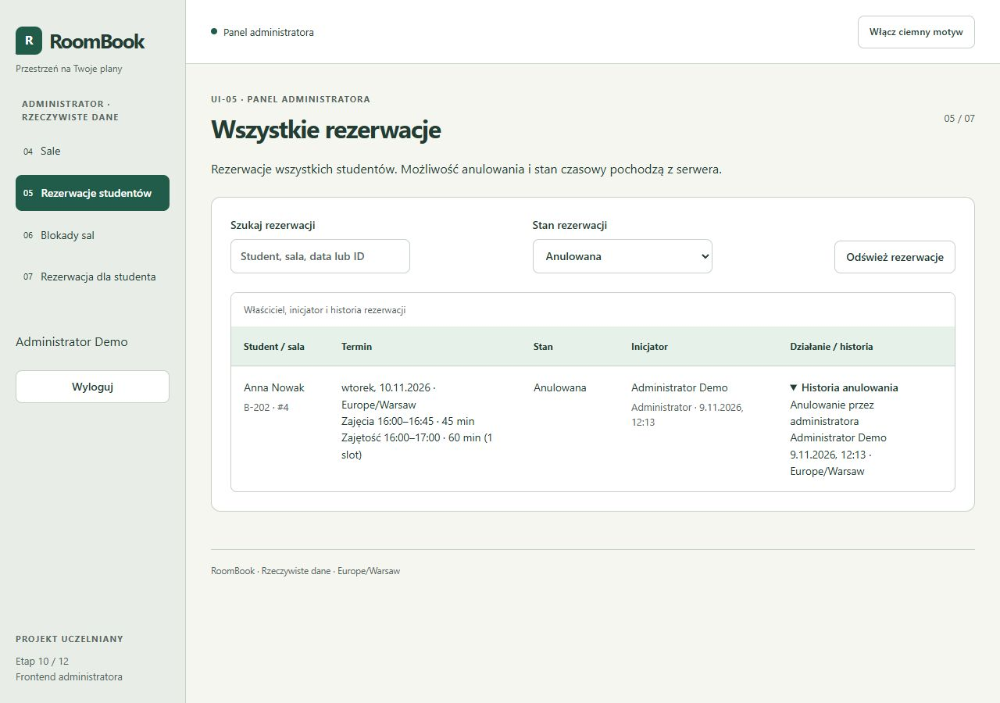

# RoomBook — ręczne przejście interfejsu

Data: 2026-11-09. Sprawdzono aplikację w widocznej przeglądarce na komputerze, a nie wyłącznie zrzuty z testów automatycznych. Lokalny frontend działa na `http://127.0.0.1:5181`, API na porcie 3021. Użyto oddzielnej migrowanej bazy i fikcyjnych kont/danych; prywatnej bazy demonstracyjnej nie zmieniano.

Sterowanie natywnym oknem Chrome zgłaszało niespójny identyfikator właściciela również po odświeżeniu okna. Kontynuowano skutecznie w widocznej karcie przeglądarki w aplikacji, na tym samym lokalnym serwerze.

| Obszar                  | Faktycznie wykonane przejście i wynik                                                                                                                                                                                |
| ----------------------- | -------------------------------------------------------------------------------------------------------------------------------------------------------------------------------------------------------------------- |
| Logowanie               | ADMIN i STUDENT zalogowani; nieprawidłowe hasło odrzucone z komunikatem; wylogowanie wraca na login                                                                                                                  |
| Sale                    | Dodano fikcyjną E-501 z nazwą/opisem/pojemnością 12, otwarto edycję, zachowano opis i zmieniono pojemność na 14; zapis widoczny na liście                                                                            |
| Dezaktywacja            | Otwarty podgląd A-101 pokazuje 1 anulowanie; powrót zamyka dialog i przywraca fokus, bez zapisu dezaktywacji                                                                                                         |
| Rezerwacje ADMIN        | Wyszukiwanie „Anna”, filtr anulowanych i rozwinięcie historii działają; widać właściciela, autora utworzenia oraz metadane anulowania                                                                                |
| Blokady                 | Wybrano dwa zajęte sloty; obie komórki zaznaczone. Dialog pokazuje powód, 120 minut i 1 anulowanie. Start 22:00 oraz przedział nachodzący na istniejącą blokadę są niedostępne. Zamknięto podgląd bez zapisu blokady |
| Rezerwacja dla studenta | Wybrano Annę, E-501 i 90 minut od 15:00; dialog rozróżnia właściciela i administratora, zajęcia 15:00–16:30 i zajętość do 17:00. Potwierdzono zapis, a wpis jest widoczny także na koncie studenta                   |
| Student                 | Kalendarz rozróżnia zajętość i blokadę; własna lista obejmuje wpis administratora. Sprawdzono zakładki nadchodzących, zakończonych i anulowanych oraz dialog anulowania z powrotem bez zapisu                        |
| Role                    | Próba wejścia studenta na UI-04 kończy się powrotem do UI-02, bez wyświetlenia panelu ADMIN                                                                                                                          |
| Wygląd                  | Jasny/ciemny motyw, szerokość 375 px, 1280 px i normalne okno; brak nakładania treści i przyciętych dialogów. Tabele na telefonie przewijają się lokalnie, umożliwiając dojście do przycisków działań                |

Ręczne operacje anulowania, dezaktywacji i tworzenia blokady zakończono na obejrzanym dialogu i bezpiecznym powrocie. Rzeczywiste zapisowe skutki tych operacji sprawdza ponowiony komplet E2E, w tym historia, atomowość, stare podglądy i utrata odpowiedzi. Nie przedstawia się samego otwarcia dialogu jako wykonanego zapisu.

## Poprawki wykryte przy przejściu

- Usunięto nieaktualne określenie administratora jako prototypu na ekranie logowania. Opisy ról mówią teraz o dostępnych funkcjach, a ekran bez sesji nie przedstawia użytkownika jako studenta.
- Przyczyny anulowania administratora są opisane po polsku; kody domenowe pozostają w API. E2E sprawdza tekst interfejsu oraz osobno `ADMIN_CANCELLED` w odpowiedzi API.
- Ukryto pusty blok komunikatów administracji, który zostawiał duży odstęp nad listą.
- Po zapisaniu sali fokus wraca do nagłówka, dzięki czemu użytkownik widzi komunikat sukcesu. Potwierdzono to ponowną edycją i zapisem E-501.

## Kontrole po poprawkach

Wszystkie polecenia zakończyły się kodem 0: lint, typecheck, `npm.cmd run test` (183/183, 45,18 s), E2E Chromium (24/24, 31,4 s), E2E Firefox (24/24, 38,3 s) i build obu workspaces. Nie zmieniono API, modelu danych ani zależności. Wcześniejszy [audyt etapu 10](AUDYT_ETAP_10.md) pozostaje zapisem poprzedniego stanu; ten dokument uzupełnia go o ręczny przegląd i drobne poprawki UI. Pracę wykonano z pomocą Codex, zachowując tożsamość i historię Git projektu.

