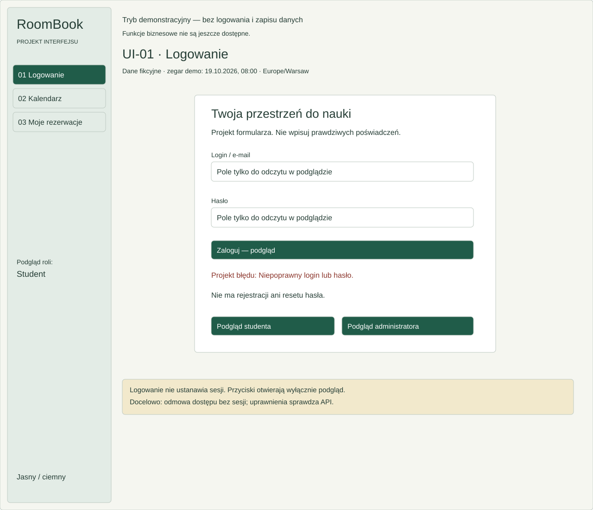
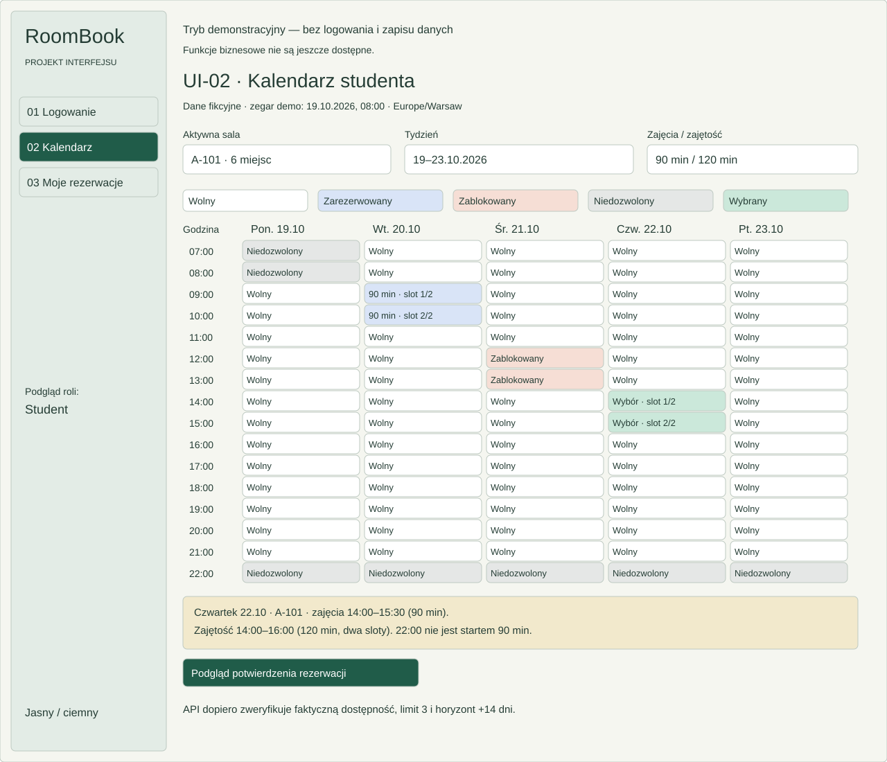
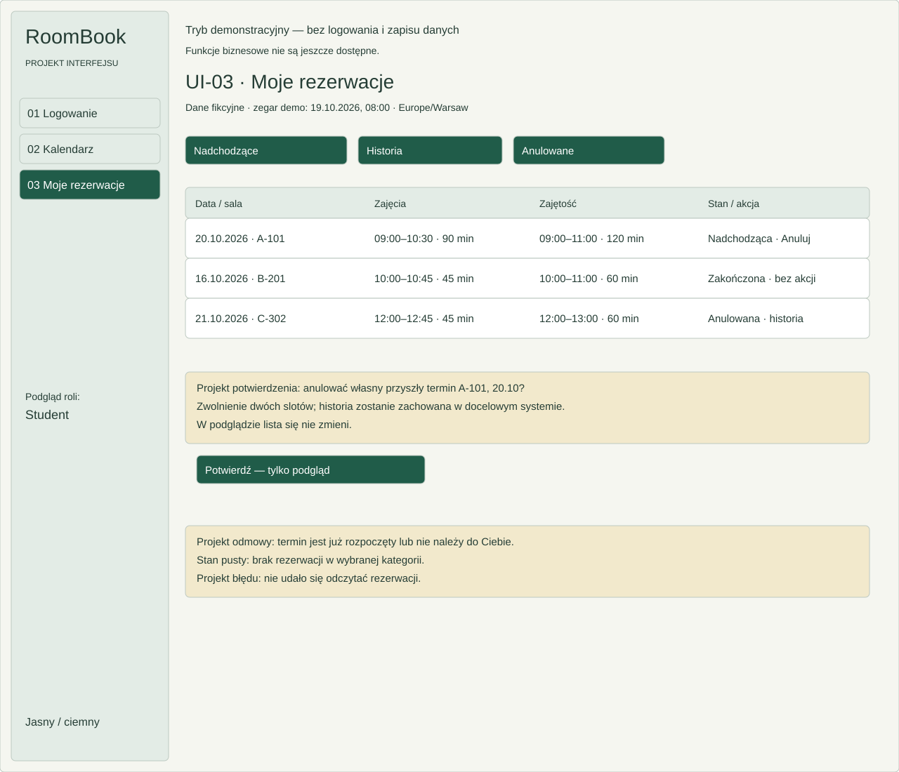
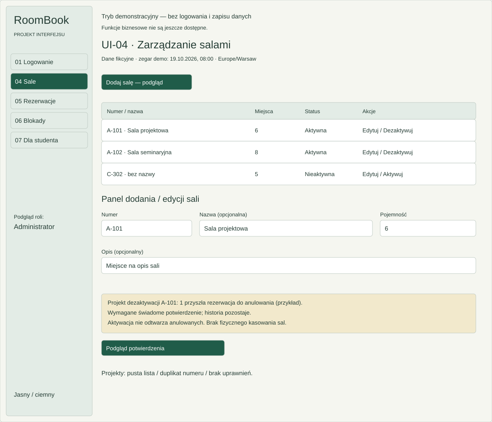
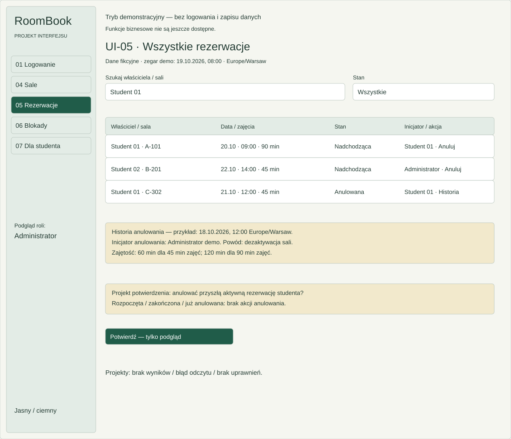
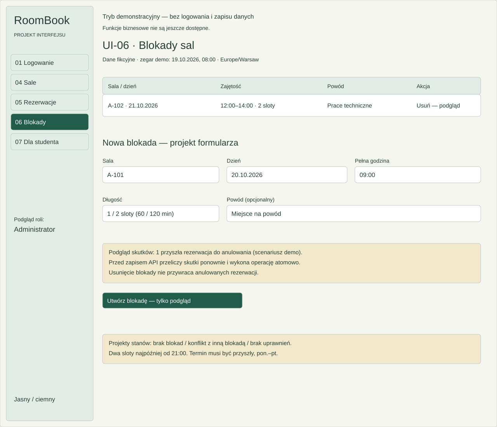
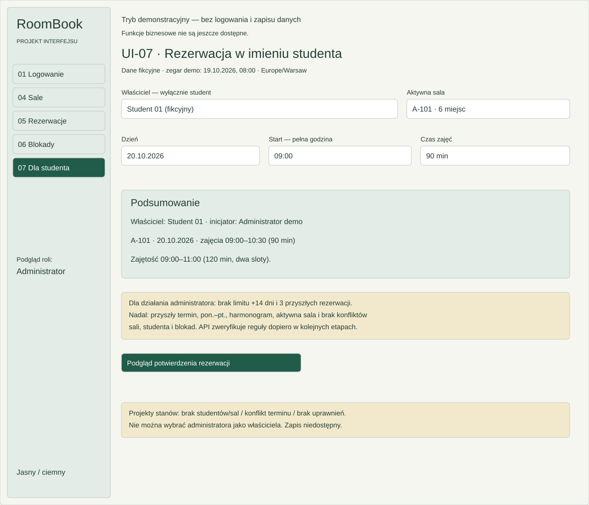

# RoomBook — makiety etapu 05

Siedem autorskich SVG przedstawia projekt P1, nie działający system rezerwacji. Wszystkie osoby i terminy są fikcyjne. Interaktywny podgląd uruchamia `npm run dev`; [nawigacja](NAWIGACJA.md) opisuje przejścia i docelowy dostęp. Podstawą są [specyfikacja, §10](../SPECYFIKACJA_ROOMBOOK.md#10-interfejs-i-nawigacja), [WF](../requirements/WYMAGANIA.md) i [UC](../use-cases/PRZYPADKI_UZYCIA.md).

| UI    | Rola                   | Cel                                          | Powiązane UC/WF                          | Plik SVG                                                                |
| ----- | ---------------------- | -------------------------------------------- | ---------------------------------------- | ----------------------------------------------------------------------- |
| UI-01 | Student, Administrator | Projekt logowania                            | UC-01; WF-01, WF-15                      | [Logowanie](wireframes/UI-01-logowanie.svg)                             |
| UI-02 | Student                | Aktywna sala, tydzień i wybór terminu        | UC-02, UC-03; WF-02, WF-03, WF-04, WF-06 | [Kalendarz](wireframes/UI-02-kalendarz.svg)                             |
| UI-03 | Student                | Własna lista i anulowanie                    | UC-04, UC-05; WF-07, WF-08, WF-15        | [Moje rezerwacje](wireframes/UI-03-moje-rezerwacje.svg)                 |
| UI-04 | Administrator          | Dane i aktywność sal                         | UC-06; WF-02, WF-11, WF-12, WF-13, WF-15 | [Sale](wireframes/UI-04-sale-admin.svg)                                 |
| UI-05 | Administrator          | Wyszukanie i anulowanie rezerwacji studentów | UC-08; WF-09, WF-10, WF-15               | [Wszystkie rezerwacje](wireframes/UI-05-rezerwacje-admin.svg)           |
| UI-06 | Administrator          | Blokady i skutki anulowań                    | UC-07; WF-14, WF-15                      | [Blokady](wireframes/UI-06-blokady-admin.svg)                           |
| UI-07 | Administrator          | Wskazanie studenta i terminu                 | UC-02, UC-03; WF-02, WF-03, WF-05, WF-06 | [Rezerwacja dla studenta](wireframes/UI-07-rezerwacja-dla-studenta.svg) |

## UI-01 — Logowanie

Login/e-mail i hasło są wyłącznie ilustracją pól: w podglądzie React są tylko do odczytu, nie zbierają poświadczeń. Przycisk otwiera informację o braku logowania. Do pozostałych ekranów prowadzi jawny wybór podglądu roli, bez tworzenia sesji.

Stan błędu: „Niepoprawny login lub hasło” jako opisany projekt komunikatu. Stan pusty: niewypełniony formularz. Nie ma rejestracji ani resetu. Odmowa dostępu jest pokazana w projekcie; faktyczna kontrola sesji należy do API.

## UI-02 — Kalendarz studenta

Wybór aktywnej sali, tygodnia i 45/90 min; pięć dni, szesnaście startów, legenda oraz podsumowanie. Dwuslotowy przykład zajmuje dwie sąsiednie komórki. Przeglądanie innych tygodni nie oznacza prawa do rezerwacji.

Stan pusty: brak aktywnych sal/terminów. Błąd: niedostępny odczyt albo konflikt po podglądzie. Niedozwolony wybór i przyczyna mają etykietę; 22:00 dla 90 min jest niedozwolone. Potwierdzenie przedstawia salę, dzień, czas zajęć i zajętość. React udostępnia projekty pustego stanu i błędu bez wysyłania żądania.

## UI-03 — Moje rezerwacje

Zakładki nadchodzących, historii i anulowanych dotyczą fikcyjnego Studenta 01. Rozpoczęcie/zakończenie to stan czasowy, nie nowy status trwały. Anulowanie jest widoczne tylko dla własnej przyszłej aktywnej pozycji względem jawnego zegara demo.

Stan pusty: brak wpisów danej kategorii. Błąd odczytu i odmowa anulowania (np. termin już rozpoczęty) są dostępne jako projekty. Potwierdzenie ostrzega o zwolnieniu slotów i zachowaniu historii; zamknięcie nie zmienia listy.

## UI-04 — Zarządzanie salami

Lista obejmuje aktywne i nieaktywne sale; panel dodania/edycji zawiera numer, nazwę, pojemność i opcjonalny opis. C-302 jest jawnie przykładowym stanem nieaktywnym, a nie zmianą początkowego seeda specyfikacji.

Stan pusty/błąd: brak wyników albo np. duplikat numeru. Dezaktywacja pokazuje demonstracyjną liczbę przyszłych anulowań i wymaga podglądu potwierdzenia. Aktywacja nie odtwarza anulowanych. Nie ma kasowania sal. Brak uprawnień jest osobnym panelem prezentacyjnym.

## UI-05 — Wszystkie rezerwacje

Filtry działają na lokalnym zestawie fikcyjnych wpisów. Tabela pokazuje właściciela, inicjatora, termin, długość i stan; anulowanie tylko dla przyszłych aktywnych. Historia anulowania obejmuje czas, inicjatora i przyczynę.

Stan pusty: brak pasujących wyników. Błąd odczytu i brak uprawnień mają projekty komunikatów. Potwierdzenie anulowania zachowuje wpis w historii; w prototypie niczego nie modyfikuje.

## UI-06 — Blokady sal

Lista i formularz: sala, data, pełna godzina, 1/2 sloty i opcjonalny powód. Projekt skutków pokazuje liczbę dotkniętych przyszłych rezerwacji, również zero. Liczba pochodzi z jawnego scenariusza demo, nie z algorytmu konfliktów.

Stan pusty: brak blokad. Błąd: przykładowe nałożenie blokady lub niedozwolony termin. Potwierdzenie utworzenia ostrzega o anulowaniach; usunięcie nie przywraca rezerwacji. Brak uprawnień jest projektem panelu.

## UI-07 — Rezerwacja w imieniu studenta

Wybór obejmuje wyłącznie fikcyjne konta studentów, aktywną salę, dzień, pełną godzinę i 45/90 min. Podsumowanie rozróżnia właściciela i administratora jako inicjatora.

Stan pusty: brak studentów lub aktywnych sal. Błąd: konflikt sali/właściciela/blokady lub niepoprawny termin. Panel potwierdzenia pokazuje 60/120 min zajętości. Brak limitu +14 dni i 3 rezerwacji nie znosi pozostałych reguł. Brak uprawnień ma projekt komunikatu.

## Decyzje wspólne

- Siatka ma 60-minutowe sloty, zajęcia trwają 45/90 min. Zajętość to odpowiednio 60/120 min z buforem. 90 min zajmuje dwie komórki; ostatni start 21:00. Dla 45 min start 22:00 zajmuje slot do 23:00.
- Stany wolny, zarezerwowany, zablokowany, niedozwolony i wybrany mają tekst i kolor. Aktywność całej sali jest niezależna od dostępności terminu. Usunięcie blokady/aktywacja sali nie odtwarza anulowanych.
- Daty są prezentowane jako `DD.MM.RRRR`, czas w formacie 24 h, strefa `Europe/Warsaw`. Stały zegar demo to 19.10.2026, 08:00; „przyszłe” dane nie zależą od dnia oglądania. To scenariusz demonstracyjny, nie aktualna dostępność.
- Docelowe role są oddzielone; przełącznik podglądu nie daje uprawnień. C4 pozostaje bez zmian: SPA → API → SQLite. Etap 05 nie łączy UI z biznesowym API ani bazą.
- Jasny/ciemny motyw korzysta wyłącznie z lokalnej preferencji wyglądu. Żadne poświadczenia ani dane demonstracyjne nie są trwale zapisywane.

## Makieta a interaktywny frontend etapu 05

| Obszar           | SVG                                            | React obecnie                                                          | Przyszła integracja 06–10                    |
| ---------------- | ---------------------------------------------- | ---------------------------------------------------------------------- | -------------------------------------------- |
| Układ            | Statyczny wspólny szkielet, przykładowe panele | Responsywna nawigacja, siedem ekranów, hash i historia                 | Zachowanie układu przy integracji            |
| Terminy          | Przykładowy tydzień i podwójne sloty           | Pełne 5 × 16, zmiana tygodnia/sali/długości, wybór                     | Rzeczywista dostępność i walidacja API       |
| Listy/formularze | Schemat kontrolek i stanów                     | Lokalne filtry, formularze i dostępne dialogi bez zapisu               | Odczyt/zapis, uprawnienia i historia z API   |
| Logowanie        | Formularz i projekt błędu                      | Pola tylko do odczytu, jawny podgląd ról bez sesji                     | Poświadczenia i sesja w etapie 06/09         |
| Operacje         | Projekt ostrzeżeń/potwierdzeń                  | Komunikat o braku zapisu, bez zmiany danych                            | Transakcje i ponowna weryfikacja na serwerze |
| Dostępność       | Etykiety i kontrast                            | Fokus, klawiatura, dialog z Escape, lokalny scroll tabel, trwały motyw | Testy pełnych procesów z API                 |

Makiety są uproszczone względem React. Implementacja prezentacyjna nie oznacza realizacji WF biznesowych ani zaliczenia TC-01…TC-26.
